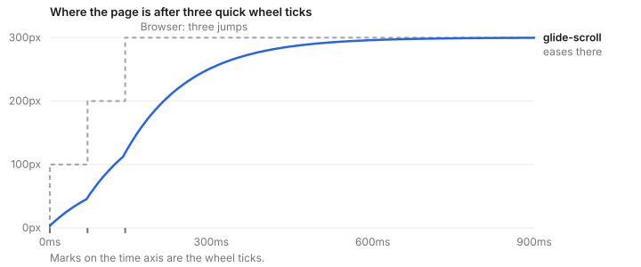

# glide-scroll

Smooth mouse-wheel scrolling for a whole page, in about 200 lines and 1.2 KB gzipped. No
dependencies.

[Demo](https://cameronspears.github.io/glide-scroll/demo/) (try it with a mouse wheel, then turn it off and compare)

```bash
npm install glide-scroll
```

```js
import { glideScroll } from 'glide-scroll';

const stop = glideScroll(); // call stop() to turn it off again
```

Or in React, once near the root:

```jsx
import { GlideScroll } from 'glide-scroll/react';

<GlideScroll />;
```

## Why not Lenis

I was using [Lenis](https://github.com/darkroomengineering/lenis) on a site with long tables. With
the CPU slowed down in Chrome's dev tools, it dropped frames. Two things cost the most: a frame loop
that ran all the time, and every row under a still mouse getting hovered and repainted as the page
moved past it.

glide-scroll only runs while the page is moving. During a glide it puts an invisible layer over the
page, so nothing underneath gets hovered until you move the mouse. On that site it cut the
main-thread work per scroll by about 60%, and hit testing went from about 67 ms to 4 ms.

It does less than Lenis. It only smooths the page itself, not elements that scroll on their own, and
it doesn't hand out scroll events for GSAP and friends. If you need either, use Lenis.

## How it moves

<picture>
  <source media="(prefers-color-scheme: dark)" srcset="https://raw.githubusercontent.com/cameronspears/glide-scroll/main/.github/assets/glide-dark.svg" />
  
</picture>

Each wheel tick moves a target, and every frame the page closes part of the gap. How much depends on
how long the frame took, so it moves at the same speed at 60 Hz and 120 Hz.

The browser keeps everything else: touch, keys, the scrollbar, sideways swipes, pinch zoom, dialogs,
and boxes with their own scrollbar (until they reach the end). A click or key press stops a glide.
People with reduced motion turned on get no glide at all.

If a device can't keep up (more than a quarter of frames late, twice in a row), it turns itself off
for the rest of the visit.

## Options

`glideScroll(options)` and `<GlideScroll {...options} />` take the same two:

- `catchUpMs` (default `120`): how quickly the page catches up. Lower is snappier.
- `storageKey` (default `'glide-scroll-off'`): the `sessionStorage` key that remembers a slow
  device. Pass `false` to never remember.

On the server it does nothing, so it's safe in SSR frameworks.

## License

MIT
